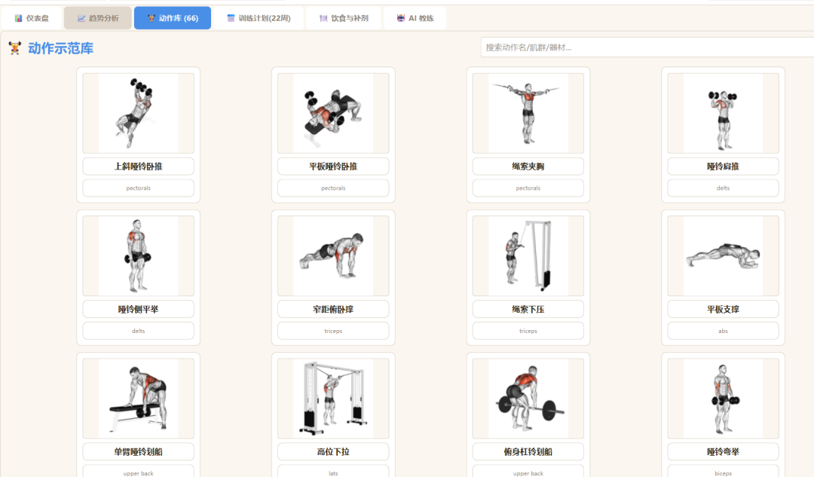
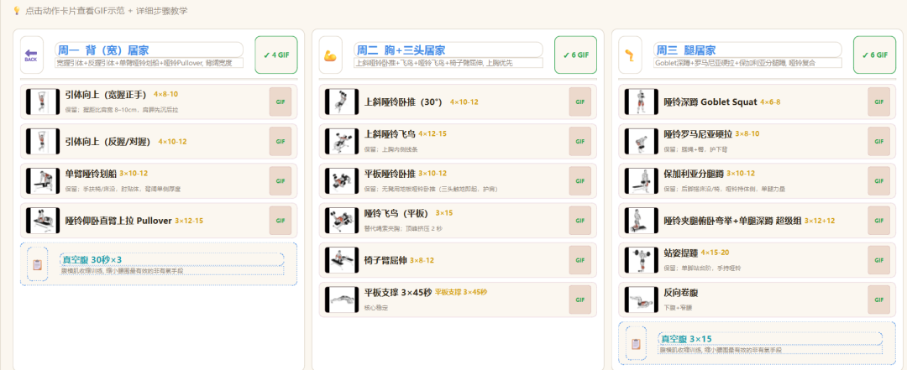
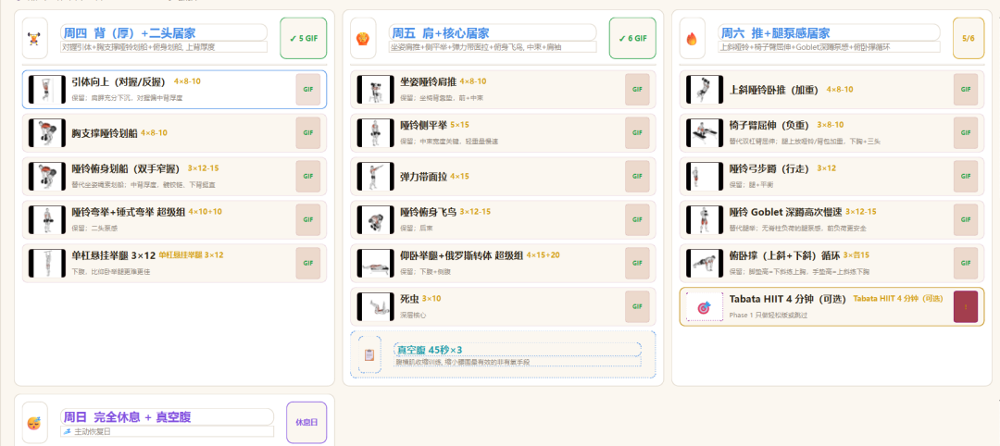
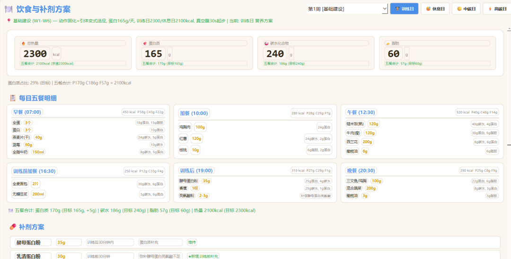
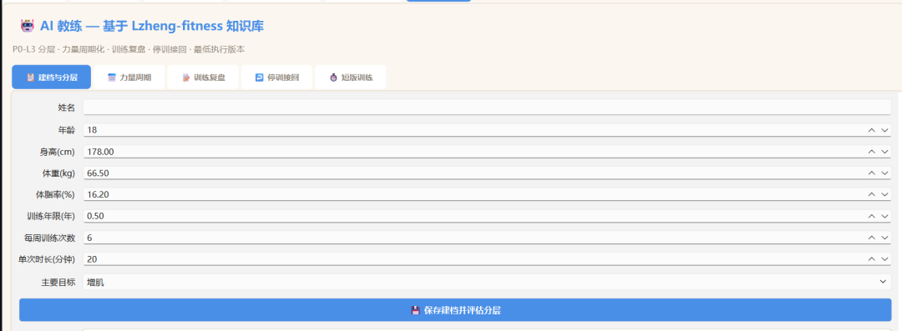
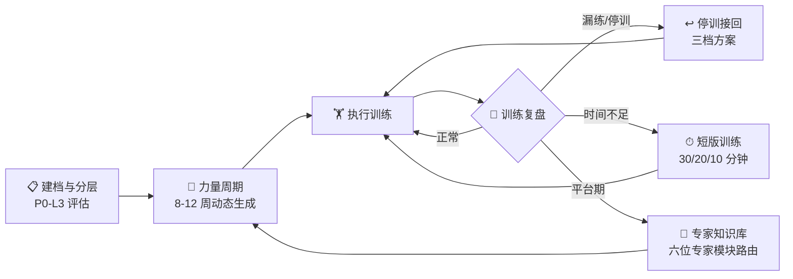
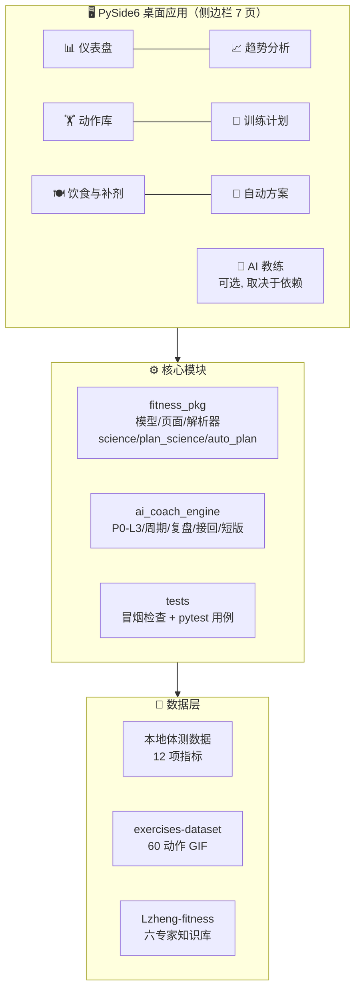
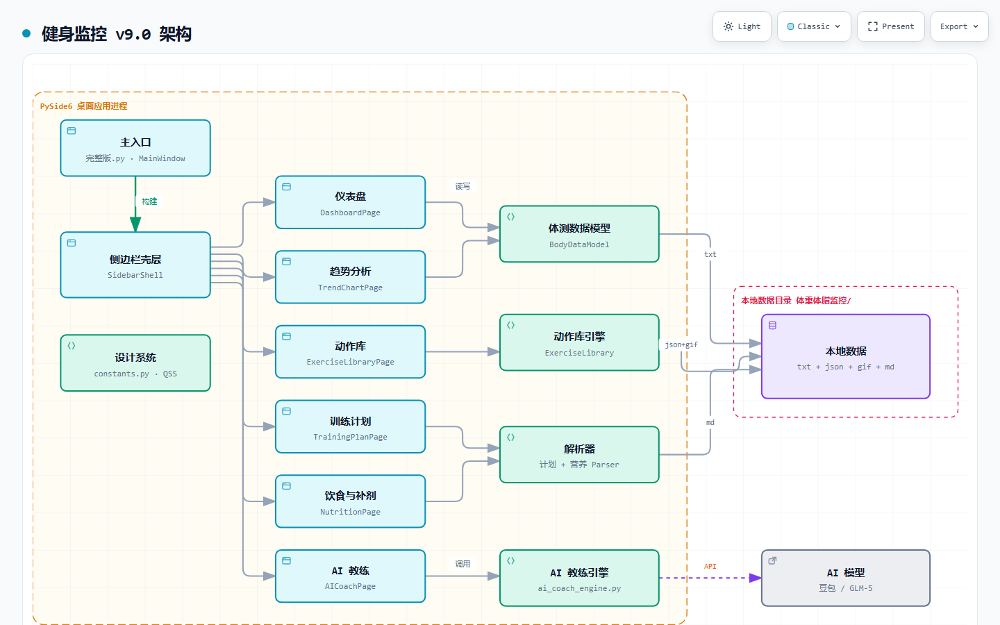

<div align="center">


# 健身监控 v9.0

**个人体脂体重监控 + 健身计划 + AI 教练**

*基于 Keep / Fitbod / Hevy / Strong 特性优化，深度集成 [Lzheng-fitness](https://github.com/yuppiez99999/Lzheng-fitness) 训练知识库*

> 上游仓库：[GitHub · yuppiez99999/fitness-tracker](https://github.com/yuppiez99999/fitness-tracker)；本仓为 [CNB 镜像](https://cnb.cool/yuppiez328/fitness-tracker)（NPC 自动开发在这里跑）。

[](https://github.com/yuppiez99999/fitness-tracker)
[](tests/)
[](https://github.com/astral-sh/ruff)
[](https://www.python.org/)
[](#-快速开始)
[](https://doc.qt.io/qtforpython/)

[](#-许可证)
[](#-许可证)
[](https://github.com/yuppiez99999/fitness-tracker/releases)
[](https://github.com/yuppiez99999/fitness-tracker/issues)

**[功能亮点](#-功能亮点) · [界面预览](#-界面预览) · [自动方案](#-自动方案-输入驱动-v92-新增) · [AI 教练](#-ai-教练-v90-新增--v91-科学规则层) · [快速开始](#-快速开始) · [架构](#-技术架构) · [项目结构](#-项目结构) · [本地校验](#-本地校验) · [知识库](#-lzheng-fitness-知识库) · [许可证](#-许可证)**

---

</div>

> ### v9.2 关键升级 · 自动方案（输入驱动）
> 新增**自动方案**（`fitness_pkg/auto_plan.py`，GUI 页「🧭 自动方案」+ CLI `auto_plan.py`）：
>
> **输入当前/目标体重体脂 → 训练计划 + 每日训练动作** · **输入月度伙食费预算 → 每日饮食计划 + 不伤身体的补剂方案**
>
> 速度上限（减脂 1% 体重/周、增肌 0.25%/周）与周组数区间全部走既有规则层；补剂只推荐常用安全品类并写明剂量上限与禁忌。
>
> ### v9.1 关键升级 · 训练科学规则层
> 深度集成 Lzheng-fitness 知识库（Schoenfeld / Helms / Aragon / Nuckols 蒸馏模块），**AI 教练**引入全新**训练科学规则层**（`fitness_pkg/science.py`，49 项规则用例）：
>
> **RPE/RIR 统一口径** · **周组数 10–20 区间校验** · **反应式减载清单** · **停滞判定** · **48 小时接回** · **30/20/10/5/2 分钟短版**
>
> ### 关于版本号
> 界面、打包配置与 `.cnb.yml` 中的程序名仍是 **v9.0**，`v9.1` / `v9.2` 指**持续迭代的功能层**
> （规则层、计划视图、自动方案），并非另一个可执行文件版本。打包产物名统一为 `健身监控v9.0.exe`，
> 以 `体脂体重监控_完整版.py`、`fitness_pkg/`、`ai_coach_engine.py` 的实际代码为准。
>
> 支持 PyInstaller 一键封装为独立 .exe，免安装 Python 直接运行。

---

## ✨ 功能亮点

| 模块 | 功能 |
|:---|:---|
| 📊 **体测仪表盘** | 12 项体测指标 · 快速录入 · 历史记录 |
| 📈 **趋势分析** | 7 日 EMA 平滑曲线 · 目标达标日预测 · 体成分饼图 |
| 🏋️ **动作示范库** | 66 个动作卡片 · 60 个 GIF 示范 · 中文步骤教学 · 肌群信息 |
| 📅 **训练计划** | 22 周宽背窄腰塑形 v2.1（三阶段周期化，6 练 1 休）· 点击动作看示范 |
| 🍽 **饮食与补剂** | 三阶段营养方案 · 五餐明细 · 补剂表 · 饮水指南 |
| 🤖 **AI 教练** | 基于 Lzheng-fitness 知识库的增肌规划系统（5 个子功能 · 规则层带单元测试） |
| 🧭 **自动方案** | 体测输入 → 训练计划与动作；预算输入 → 每日饮食与补剂（速度上限/组数区间/剂量上限均走规则层） |

---

## 🖼️ 界面预览

### 🏋️ 动作示范库
<p align="center">
  
</p>

> 66 个动作的网格卡片布局（其中 60 个带 GIF 示范），支持按动作名 / 肌群 / 器材搜索，点击卡片即可查看 GIF 与详细步骤教学。
> 截图取自 `assets/screenshots/`（共 5 张，覆盖动作库 / 训练计划 / 饮食 / AI 教练）；**「自动方案」页暂无截图**，待本地 Windows 界面确认后补充。
> 需要重新生成时，跑 `python _ui_shot.py`（离屏渲染，输出 `_shot_tab*.png`）。

---

### 📅 训练计划（22 周周期化）

<p align="center">
  
</p>

<p align="center">
  
</p>

> 6 练 1 休的完整周期安排：背（宽）→ 胸 + 三头 → 腿 → 背（厚）+ 二头 → 肩 + 核心 → 推 + 腿泵感 → 完全休息。每日动作带 GIF 预览、组数次数标注与替代方案说明。

---

### 🍽 饮食与补剂方案

<p align="center">
  
</p>

> 训练日 / 休息日差异化热量结构，实时追踪蛋白质、碳水、脂肪三大宏量。五餐明细含精确克数与热量标注，补剂方案按训练前后时段智能推荐。

---

### 🤖 AI 教练

<p align="center">
  
</p>

> 基于 Lzheng-fitness 六位专家知识库的纯本地智能规划。建档后自动评估 P0-L3 训练阶段，生成个性化力量周期、训练复盘与停训接回方案。

---

## 🧭 自动方案 · 输入驱动 (v9.2 新增)

两条输入 → 两条输出，规则全部复用既有规则层，页面与 CLI 同源：

| 输入 | 输出 |
|:-----|:-----|
| 当前体重 / 体脂率 + 目标体重 / 体脂率（可选身高/年龄/性别/训练年限） | 训练计划：方向 + 周期周数 + P0–L3 等级 + 每周分化 + **每日动作的组×次×RPE** |
| 月度伙食费预算 | 每日饮食计划：热量与三大宏量 + 六餐份量与采购参考 + 补剂清单（含剂量上限与禁忌） |

```bash
# GUI: 左侧「🧭 自动方案」页, 填参数点「生成方案」
# CLI: 不读写任何个人数据, 直接出 Markdown
python auto_plan.py --weight 74 --bodyfat 23 --target-weight 68 --target-bodyfat 15 --budget 1500 --height 175
python auto_plan.py --weight 74 --bodyfat 23 --target-bodyfat 15 --budget 1500 --out 方案.md   # 落成文件
```

CLI 参数（`--weight` 必填，其余可选）：

| 参数 | 说明 | 默认 |
|:-----|:-----|:-----|
| `--weight` | 当前体重 (kg)，必填 | — |
| `--bodyfat` / `--target-bodyfat` | 当前 / 目标体脂率 (%) | 不填则按体重单指标推算 |
| `--target-weight` | 目标体重 (kg) | 不填则按目标体脂推算 |
| `--budget` | 月度伙食费预算 (元)；**不填则只出训练计划，跳过饮食与补剂** | — |
| `--height` / `--age` / `--sex` | 身高 (cm) / 年龄 / 性别（`male` / `female`） | 影响 BMI、等级与起点负荷 |
| `--training-age-months` | 训练年限（月） | `0`（按 P0 启动期处理） |
| `--weeks` / `--week` | 计划周期（周）/ 当前第几周 | 按目标自动推算 / `1` |
| `--out` | 写入指定 Markdown 文件 | 仅打印到终端 |

> 实测（74kg / 23% → 68kg / 15%，预算 1500，训练年限 0）：识别为**减脂**方向、**P0 启动期**、每周 3 练全身分化，
> 组数区间 6–10 组/肌群；每个动作给出「3×8-12 @RPE 6.0–7.0」，并附执行纪律（复合主项留 1–2 RIR、组间休息下限、就医触发条件）。

**安全约束（写死在代码里, 不是文案）**

- 减脂周速度上限 **1% 体重**、增肌 **0.25% 体重**；目标再激进也只会延长周期，不会加大缺口
- 目标体脂触发但体重得动更多时，按「保住去脂体重」推算目标体重并提示差异
- 体脂接近必需脂肪区间（男 ≤5% / 女 ≤12%）→ 提示不建议继续减脂，先做医学评估
- 补剂只保留乳清/肌酸/维D3/鱼油/镁/锌这类常用安全品类，每项写明**剂量上限与禁忌**
- 补剂占比不超过预算 15% 且不超过 25 元/天：钱先花在真食物上，蛋白缺口优先补齐
- 补剂红线（燃脂丸、促生长类、利尿剂等）直接列为不碰项；有基础病/服药/孕期先问医生

---

## 🤖 AI 教练 (v9.0 新增 · v9.1 科学规则层)

集成 Lzheng-fitness 的 6 位顶级训练专家知识（Alan Aragon、Brad Schoenfeld、Brukner & Khan、Dan John、Eric Helms、Greg Nuckols），**纯 Python 实现，离线运行，无需 AI 对话**。

| 子功能 | 说明 |
|:------|:-----|
| 📋 建档与分层 | P0-L3 四级训练阶段评估（启动/动作稳定/周管理/阶段进步）+ 周组数区间校验 |
| 📅 力量周期 | 8-12 周动态周期生成（积累→强度→实现→减量），含热身流程、顶组+回退组、逐组 RPE 路径 |
| 📝 训练复盘 | 单次训练复盘 + 渐进超负荷决策（双重渐进：先加次再加重）+ 反应式减载清单 + 停滞检测 |
| ↩️ 停训接回 | 三档接回方案（正常/降级/最低）+ 48 小时接回动作 + 升级/维持/暂停条件 |
| ⏱ 短版训练 | 30/20/10/5/2 分钟最低执行版本 + 动作模式缺口审计 |

### 训练科学规则层 `fitness_pkg/science.py`

把 Lzheng-fitness 知识库里的判断规则收敛为**可配置、可测试**的参数（`tests/` 下用例覆盖规则层 / AI 引擎 / 数据层 / 解析器 / 计划视图 + `tests/smoke_check.py` 冒烟）。

| 规则 | 口径 | 来源 |
|:-----|:-----|:-----|
| RPE/RIR | RPE 10 ≈ 0 RIR、9 ≈ 1 RIR、8 ≈ 2 RIR、7 ≈ 3 RIR，半档取更保守一侧 | Helms 训练金字塔 pp.64-65 |
| 周组数 | 每肌群/动作模式 **10–20 组起始区间**（非上限），按 P0–L3 分层取值 | Helms Level 2；Nuckols：训练量是可检验剂量 |
| 组间休息 | 复合主项 ≥2.5 分钟、孤立动作 ≥1.5 分钟；时间紧用拮抗肌配对组 | Helms Level 5 pp.171-187 |
| 力竭使用 | 多数组保留 1–2 RIR；复合主项常规不做力竭，孤立动作仅**末组**可接近 | Schoenfeld 第 4 章 |
| 渐进方式 | 复合动作用线性/波浪周期，孤立动作优先双重渐进（先加次再加最小重量档） | Helms Level 3 pp.99-125 |
| 自动调节 | 按 e1RM 与目标 RPE 校正当日负荷；一次只动一个主要变量 | Nuckols 自动调节/APRE |
| e1RM 口径 | 先按 RIR 折算到「当天力竭会用的重量」再套 Epley，与负荷换算互为逆运算；不再把当前次数当力竭次数 | Lzheng 03 |
| 节律减载 | 约每 4 周一次，且减载周强度必须**低于任何实现周**；连续 3 个中周期未减载 → 预防性减载 | Helms pp.121-125 |
| 反应式减载 | 命中 2 项及以上（不想训练/睡眠差/表现下降/压力大/疼痛加重）→ 减载一周 | Helms pp.121-125 |
| 停滞判定 | 同重量掉次数或同组次 RPE 升约一级，**连续两次**才怀疑结构 | Lzheng 03/05 |
| 安全分流 | 胸痛/晕厥/麻木/放射痛等危险信号直接暂停常规处方并建议专业评估 | Lzheng 01；ACSM/WHO 核验入口 |
| 短版训练 | 保留当天主线、先减附件、不压缩复合主项休息；漏 1 次不补课、漏 2 次用短版接回 | Lzheng 04；Helms Level 5 |

**口径提示**：全部负荷与 1RM 都是**估算起点**，真正准的是每次训练的 RPE 反馈，别用公式替代记录。

### 22 周计划的科学化视图 `fitness_pkg/plan_science.py`

把规则层接到「22 周居家平替计划」的展示口径上，供训练计划页与报告共用同一套判断。

**关键口径**：Helms 的 10–20 组/周是**每周每肌群**计量，而周计划正文写的是「单次训练该动作做几组」，
两者不是同一个量纲。所以这里只在能确定频率时才算周组数——`estimate_weekly_sets` 先把一周 7 天各自的动作表
汇总，再与起始区间比对；解析不到有效组次（休息周或文档缺失）时返回**「不判定」**，不误报「练得太少」。

| 能力 | 说明 |
|:-----|:-----|
| 组次解析 | `parse_group_spec` 兼容「4×8-10」「4组×8-10次」「3x12」「5组」「4 循环」，解析不出返回 0 组交给调用方降级 |
| 肌群归类 | `muscle_bucket_of` 按最长关键词匹配（避免「引体」被「臂屈伸」抢走），归类不了的动作进 `unclassified` 而不是静默计入 |
| 周组数判定 | `weekly_volume_status` 给出 偏少/合适/偏高/超出验证区间 四档结论与调整方向，区间来自 `weekly_set_band(level)` |
| 周视图元数据 | `week_display_meta` 给出阶段口径、是否减载周、组数保留比例、力竭策略、短版接回规则 |
| 减载指引 | `deload_guidance` 复用规则层的反应式清单（命中 2 项即减载一周），不在视图层另立阈值 |



---

## 🚀 快速开始

### 方式一 · 免安装运行（需先自行打包）

> ⚠️ **当前仓库不含已编译的 exe，也不含 `dist/` 目录** —— 封装配置齐全，但产物需要在 **Windows 本机**生成
> （PySide6 桌面程序无法跨平台打包，Qt 插件、`fitness_icon.ico` 与中文字体都是 Windows 资产）。

1. 在 Windows 上按下面「封装为独立 .exe」跑一次 `python build_exe.py`
2. 得到 `dist\健身监控v9.0\` 整个目录
3. 把**整个目录**（不要只拷 exe）复制到任意 Windows 电脑，双击 `健身监控v9.0.exe` 即可运行

打包好的压缩包建议归档到本仓 Releases / 制品库，供免安装下载。

### 方式二 · 源码运行（推荐，开箱可用）

- Python 3.8+
- 建议使用虚拟环境运行，避免全局包冲突

```bash
# 克隆仓库（含子模块）
git clone --recurse-submodules https://cnb.cool/yuppiez328/fitness-tracker.git
cd fitness-tracker

# 创建虚拟环境
python -m venv .venv
.venv\Scripts\Activate.ps1

# 安装依赖
pip install PySide6 matplotlib pandas numpy Pillow

# 直接运行
python 体脂体重监控_完整版.py
```

也可双击 `启动体脂体重监控.bat` 一键启动（Windows）。

### 封装为独立 .exe

```bash
pip install pyinstaller
python build_exe.py          # 推荐: 一键打包（含图标 + 精简排除项）
# 或使用 spec 文件:
python -m PyInstaller 健身监控v9.0.spec --noconfirm --clean
# 产物: dist\健身监控v9.0\健身监控v9.0.exe
```

> 启动异常需要看报错时，改用 `健身监控_debug.spec`（保留控制台窗口，产物名 `健身监控v9.0_debug`）。

| 打包入口 | 产物名 | 状态 |
|:---------|:-------|:-----|
| `build_exe.py` | `健身监控v9.0.exe` | ✅ **推荐**，已含图标 + 精简排除项 |
| `健身监控v9.0.spec` | `健身监控v9.0.exe` | ✅ **维护中**，已补 `fitness_pkg.auto_plan` / `auto_plan_page` / `science` / `plan_science` 的 `hiddenimports` |
| `健身监控_debug.spec` | `健身监控v9.0_debug.exe` | ✅ 保留控制台，用于排查启动异常 |
| `健身监控.spec` | `健身监控v9.0.exe` | ⚠️ **旧版，未同步自动方案模块**，建议勿用（保留仅作参考） |

> `dist/` 与 `build/` 已在 `.gitignore` 中，仓库不提交编译产物。

---

### 🛠️ 代码质量工程化（集成自 GitHub 开源工具）

主代码（`fitness_pkg/`、`ai_coach_engine.py` 等）集成三条开源质量链，提交即自动把关：

| 工具 | GitHub 仓库 | 作用 |
|:-----|:------------|:-----|
| **ruff** | [astral-sh/ruff](https://github.com/astral-sh/ruff) | 极速 Python lint + formatter（替代 flake8/black/isort） |
| **pre-commit** | [pre-commit/pre-commit](https://github.com/pre-commit/pre-commit) | git 提交钩子，自动跑通用检查 + ruff |
| **pytest** | [pytest-dev/pytest](https://github.com/pytest-dev/pytest) | 单元/构造冒烟测试（数据层/解析器/规则层/计划科学视图/AI 引擎/自动方案），实测 **213 passed · 5 skipped**（缺 PySide6 时**自动跳过** UI 用例） |

```bash
# 一次性安装钩子（此后每次 git commit 自动检查）
.\.venv\Scripts\python.exe -m pre_commit install

# 手动跑全部检查
.\.venv\Scripts\python.exe -m ruff check .        # lint
.\.venv\Scripts\python.exe -m ruff format .        # 统一格式
.\.venv\Scripts\python.exe -m pytest tests         # 测试
.\.venv\Scripts\python.exe -m pre_commit run --all-files
```

质量基线：**目标 Python 3.8 兼容**（`pyproject.toml` → `[tool.ruff] target-version`），
个人/归档脚本（`补全数据.py`、`体脂体重监控全系列脚本/` 等）已排除在门禁外。

---

## 🏗️ 技术架构



### 📐 架构总览（archify 生成）

<p align="center">
  
</p>

> 架构图（`docs/` 下 archify 产物，标题与节点仍标 v9.0）：主入口 → 侧边栏壳层 → 功能页面 → 业务逻辑模块 → 本地数据 / 知识库。
> 完整交互式架构图（支持主题切换 / 平移缩放 / 关系追踪）见 [`docs/fitness-arch.html`](docs/fitness-arch.html)（下载后本地打开）。
>
> 侧边栏实际有 **7 页**：仪表盘 / 趋势分析 / 动作库 / 训练计划 / 饮食与补剂 / 自动方案 / AI 教练；
> 其中 **AI 教练页仅在依赖齐全时挂载**（`AI_COACH_AVAILABLE`），`docs/` 里的旧图未包含「自动方案」页。

| 类别 | 技术 |
|:-----|:-----|
| GUI 框架 | PySide6 |
| 数据/绘图 | matplotlib · pandas · numpy · Pillow |
| 打包分发 | PyInstaller |
| 代码质量 | ruff · pre-commit · pytest（详见「代码质量工程化」） |
| 数据源 | [exercises-dataset](https://github.com/yuppiez99999/exercises-dataset)（Git 子模块） |
| 知识库 | [Lzheng-fitness](https://github.com/yuppiez99999/Lzheng-fitness)（Git 子模块） |

---

## 🧠 AI 教练知识来源

Lzheng-fitness 知识库包含 6 个来源限定专家模块：

| 专家 | 领域 | 应用场景 |
|:-----|:-----|:---------|
| Brad Schoenfeld | 肌肥大科学 | 训练量、频率、RIR 设置 |
| Eric Helms | 训练金字塔 | 周期结构、阶段过渡 |
| Alan Aragon | 营养策略 | 热量缺口、宏量配比 |
| Greg Nuckols | 力量停滞 | 突破平台期、变量实验 |
| Dan John | 基础训练 | 目标脱节时回到基础 |
| Brukner & Khan | 临床运动 | 安全筛查、疼痛分流 |

---

## 📚 Lzheng-fitness 知识库

> 详细说明见子模块 `Lzheng-fitness/README.md`。本仓库以 Git 子模块方式集成，克隆时请用 `--recurse-submodules`。

可独立下载、离线运行的个人训练 Agent Skills。v2 将计划、专项周期、训练复盘、停训接回、系统总控与健身工作台组合为一个可迁移的本地训练闭环。公开包不含任何个人训练数据、账号信息或绝对路径。

| Skill | 用途 |
| --- | --- |
| `lzheng-fitness-plan` | 训练建档、安全筛查、完整计划与 HTML |
| `lzheng-training-return` | 停训、漏练或条件变化后的接回 |
| `lzheng-strength-cycle-planner` | 单个力量动作的 8—12 周周期 |
| `lzheng-strength-training-review` | 单次、滚动、基准与周训练复盘 |
| `lzheng-training-expert-library` | 六个来源限定专家模块、选择协议和验证状态 |
| `lzheng-training-system` | 新电脑初始化、迁移、诊断、升级保护和整套校验 |
| `lzheng-fitness-workbench-builder` | 从计划、复盘和可选动态数据生成响应式离线工作台 |

安装（需 Python 3.10+，无需第三方包）：

```bash
python Lzheng-fitness/tools/install.py --platform codex --all
```

安装完成后，在新对话中说"**开始建立我的健身系统。**"即可由 AI 引导完成建档、动作重量校准、正式计划与工作台。发布前可用 `python Lzheng-fitness/tools/validate_bundle.py` 验证（检查元数据、链接、隐私残留与脚本语法）。

---

## 📋 训练计划模板亮点

<details open>
<summary><b>22 周宽背窄腰塑形计划（通用模板，点击收起）</b></summary>

所有身体数据均为占位示例，使用前请按个人体测值替换，热量与训练量可按自身 TDEE 调整。

| 维度 | 模板基线 | 模板优化 |
|:-----|:---------|:---------|
| 热量结构 | 单一缺口 | 训练日 / 休息日差异化热量 |
| 背周总量 | 30 组 | 18–22 组（周一 10 + 周四 8–12） |
| 俯身划船 | 周四主项 | T 杠划船 / 胸支撑划船（护腰） |
| 阿诺德推举 | 肩日主项 | 坐姿哑铃肩推（护肩袖） |
| 空腹有氧 | Phase 2 启动 | Phase 1 完全不做，Phase 2 最多 2 次 |
| 补剂 | 堆叠 9 种 | 精简至 5 必需 + 3 建议 |
| 真空腹 | 60 秒 ×5 | 30→45→60 秒递进 |

**训练日程（6 练 1 休）**：背（宽）→ 胸（上胸优先）→ 腿（四头为主）→ 背（划船）→ 肩 + 臂 → 全身 HIIT + 冲刺 → 完全休息。

</details>

---

## 📁 项目结构

<details>
<summary><b>展开目录树</b></summary>

```
fitness-tracker/
├── 体脂体重监控_完整版.py           # 主程序入口（PySide6 GUI，侧边栏 7 页）
├── fitness_modules.py               # 兼容层：re-export fitness_pkg（旧调用方无需改动）
├── fitness_pkg/                     # 核心包（模型/动作库/解析器/弹窗/页面/AI教练页）
├── fitness_pkg/science.py           # 训练科学规则层（RPE/RIR、周组数、减载、停滞、缺口审计）
├── fitness_pkg/plan_science.py      # 22 周计划的科学化视图（组次解析/肌群归类/周组数判定/减载周展示）
├── fitness_pkg/auto_plan.py         # 输入驱动方案生成（体测→训练计划+动作，预算→饮食+补剂）
├── fitness_pkg/auto_plan_page.py    # 「自动方案」页面（参数收集 + 文本渲染，规则复用 auto_plan）
├── auto_plan.py                     # 同一条链路的命令行入口（不读写个人数据）
├── ai_coach_engine.py               # AI 教练引擎（P0-L3/周期/复盘/接回/短版 + 规则层）
├── tests/                           # smoke_check.py 冒烟 + 单元/构造用例（缺 GUI 依赖自动跳过）
├── cairn/                           # ROADMAP 与开发日志（NPC 自动开发排期事实源）
├── 健身监控v9.0.spec                 # PyInstaller 主打包配置（正式版）
├── 健身监控_debug.spec               # 调试打包配置（带控制台，便于排查启动异常）
├── build_exe.py                     # 命令行一键打包脚本
├── fitness_icon.ico                 # 应用图标
├── 启动体脂体重监控.bat             # Windows 一键启动脚本
├── Lzheng-fitness/                  # 知识库子模块（Schoenfeld/Helms 等 6 专家）
├── generate_report.py               # 报告生成工具
├── 补全数据.py                       # 体测数据补全脚本
├── _ui_shot.py                      # 离屏渲染页面截图（视觉验证用）
├── .cnb.yml / .cnb/                 # CNB 双轨 NPC 流水线与仓库配置
├── .pre-commit-config.yaml          # git 提交钩子（ruff + 通用检查）
├── pyproject.toml                   # 依赖与 ruff / pytest 配置
├── docs/                            # 架构图产物（archify generated）
├── .venv/                           # 虚拟环境（不提交）
├── exercises-dataset/               # 动作数据集子模块（Git 子模块）
├── dist/                            # 封装产物（.gitignore 排除，需本地打包生成）
│   └── 健身监控v9.0/
│       └── 健身监控v9.0.exe          # PyInstaller 产物（仓库不含，需本地 Windows 生成）
├── 体重体脂监控/                     # 训练计划与资源
│   ├── 训练计划文档（.md）            # 个人训练计划（本地个人数据，不提交）
│   ├── ai_coach/                    # AI 教练数据（本地个人数据，不提交）
│   ├── exercises_gif/               # 60 个动作示范 GIF
│   ├── exercises_matched.json       # 66 个动作 与 GIF 映射
│   ├── match_exercises.py           # 动作匹配脚本
│   ├── 报告/                         # 体测报告 TXT（本地个人数据，不提交）
│   └── 图表/                         # 趋势图 PNG（本地个人数据，不提交）
└── README.md
```

</details>

## 🧪 本地校验

```bash
# 冒烟: py_compile 全部核心模块 + 规则层断言 + 引擎端到端 + 4 项口径不变量
python tests/smoke_check.py

# 自动方案链路（无需 GUI）: 体测/预算校验、速度上限、减载不变量、份量标签、补剂红线
python auto_plan.py --weight 74 --bodyfat 23 --target-weight 68 --target-bodyfat 15 --budget 1500 --height 175

# 单元测试: RPE/RIR、e1RM 互逆、周组数与区间判定、周期/减载、组次解析、安全分流、复盘、接回、短版、自动方案
python -m pytest tests
python -m unittest discover -s tests   # 与上同源, 不装 pytest 时可用

# 代码风格（与 pre-commit 一致）
python -m ruff check .
python -m ruff format --check .
```

当前实测（Python 3.11，无 PySide6）：

| 命令 | 结果 |
|:-----|:-----|
| `python -m pytest tests` | **213 passed · 5 skipped** |
| `python tests/smoke_check.py` | **4 组全过** |
| `python -m ruff check .` / `ruff format --check .` | **全绿** |
| `python auto_plan.py --weight 74 --bodyfat 23 --target-bodyfat 15 --budget 1500` | 正常输出 Markdown 方案 |

> 规则层口径已收敛到 `fitness_pkg/science.py` 单一来源，引擎、GUI、自动方案 (`auto_plan.py`) 与 22 周计划视图 (`plan_science.py`) 都按它下判，避免两套逻辑打架。
> 自动方案的周组数区间 / 速度上限 / 减载标注全部复用这套规则层，视图层不另算阈值。
> GUI 相关改动无法在无显示器环境验证，建议在本地 Windows 打开界面确认一次（见 `cairn/ROADMAP.md` 开放问题）。
> 缺 PySide6 / numpy / pandas 时相关用例自动跳过；`import fitness_pkg` 本身**不要求** PySide6，
> 纯逻辑层（数据模型 / 解析器 / 规则层 / 计划科学视图）在 CI 与 CLI 里可直接用，
> 降级状态见 `fitness_pkg.GUI_AVAILABLE` / `GUI_IMPORT_ERROR`。

## 📊 数据说明

<details>
<summary><b>展开数据指标与存储说明</b></summary>

- 体测数据支持 12 项指标：日期、体重、体脂率、肌肉量、内脏脂肪等级、基础代谢率、体水分率、骨量、BMI、骨骼肌率、腰围、臀围
- AI 教练数据存储在 `体重体脂监控/ai_coach/`（建档、周期 JSON、复盘记录、周期 MD），该目录为本地个人数据，不随仓库分发
- 个人训练计划文档（`体重体脂监控/*.md`）含个人执行数据，同样仅保存在本地，不随仓库分发
- 目标体重 / 目标体脂率可在建档时自定义
- 变化值以"当前 - 初始"计算，降低会显示为负数

</details>

---

## ⚠️ 注意事项

- 本项目为个人健身工具，数据存储在本地
- 敏感个人信息（体测记录、训练计划、AI 教练数据）已排除在版本控制与 Git 历史之外
- 虚拟环境目录 `.venv` 不提交到仓库
- 训练计划文档中的身体数据均为通用示例，使用前请替换为个人体测值
- AI 教练提供一般训练规划支持，不作医疗诊断或康复建议
- 所有负荷与 1RM 数字都是**估算起点**，请以实际表现的 RPE 反馈为准，不要用公式替代记录
- 空腹有氧、HIIT、断食等策略不通过“惩罚性有氧”执行；时间不足时优先减附件而不是压缩主项休息
- **版本号口径**：程序名统一为 v9.0，`v9.1` = 训练科学规则层，`v9.2` = 自动方案；不是三个独立可执行文件
- **exe 未随仓库分发**：`dist/` 已被 `.gitignore` 排除，需要免安装版请在 Windows 本机跑一次 `build_exe.py`
- **已知未完成项**：「自动方案」页的 GUI 布局仅在离屏环境验证过构造，需本地打开确认一次；减载周的饮食尚未随训练量联动（见 `cairn/ROADMAP.md` F12）

---

## 📄 许可证

<div align="center">

**PolyForm Noncommercial License 1.0.0**

**非商业用途 · 必须署著作名**

</div>

| | |
|:---|:---|
| ✅ **允许** | 个人使用 · 学习研究 · 兴趣项目 · 修改自用 · 非商业组织使用 · 学术引用 |
| ❌ **禁止** | 商业产品/服务 · 企业商业运营 · 付费分发 · 商业 AI 训练 · 移除署名 · 再许可 |
| ✍️ **署名** | 分发时必须原样保留以下署名行与许可证全文/URL |

```text
Required Notice: Copyright (c) 2026 yuppiez99999 (https://github.com/yuppiez99999)
```

完整法律文本见 [`LICENSE`](./LICENSE)，完整条款说明见下方折叠：

<details>
<summary><b>📖 查看完整许可证条款（授权范围 / 非商业定义 / 子模块边界 / MIT 差异 / 引用格式）</b></summary>

### 授权范围（允许）

| 用途 | 是否允许 | 说明 |
|:-----|:---------|:-----|
| 个人健身记录、体测追踪 | ✅ | 本软件的原始设计目的 |
| 个人学习、研究、实验 | ✅ | 不含任何预期商业应用 |
| 兴趣项目、业余爱好、私人娱乐 | ✅ | PolyForm NC 明确列入 Personal Uses |
| 修改、二次开发、自用分支 | ✅ | 须保留署名与本许可证条款 |
| 慈善机构、教育机构、公共研究机构、政府机构使用 | ✅ | 无论资金来源均允许 |
| 公开分发源码或构建产物 | ✅ | 须附带本许可证全文与署名行 |
| 学术论文引用、教学示例 | ✅ | 须署名 |

### 禁止范围（不允许）

| 用途 | 是否允许 | 说明 |
|:-----|:---------|:-----|
| 任何直接或间接收费的商业产品或服务 | ❌ | 包括付费 App、SaaS、内嵌收费模块 |
| 企业内部商业运营、员工健身福利商业化产品 | ❌ | 商业实体内部使用须另行授权 |
| 二次开发后以商业方式发行或销售 | ❌ | 衍生作品继承非商业约束 |
| 用于训练商业 AI 模型或数据集 | ❌ | 衡生数据集同样受非商业约束 |
| 移除、隐藏或篡改署名行 `Required Notice` | ❌ | 违反 Notices 条款，许可证立即终止 |
| 重新许可（sublicense）或转让本许可证 | ❌ | PolyForm NC 明确禁止 |

> **商业授权**：如需将本软件用于商业用途，请通过 [Issues](https://github.com/yuppiez99999/fitness-tracker/issues) 联系作者另行签订商业许可协议。

### 署名要求（必须）

按 PolyForm NC 1.0.0 的 **Notices** 条款，分发本软件任意部分时必须同时附带：

1. **本许可证全文或其 URL**：`https://polyformproject.org/licenses/noncommercial/1.0.0`
2. **署名行（Required Notice）**，原样保留不得修改：
   ```
   Required Notice: Copyright (c) 2026 yuppiez99999 (https://github.com/yuppiez99999)
   ```
3. 若本软件附带了其他 `Required Notice:` 开头的纯文本行，须一并原样传递。

署名不得移除、隐藏、缩印或改写。在 About 对话框、README、启动画面、关于页等显著位置展示即视为满足"获得副本者同时获得署名"的要求。

### 非商业用途定义

PolyForm NC 1.0.0 中的"非商业"采用正向定义，**任何非商业目的均为许可目的**，具体包括：

- **个人使用**：研究、实验、为公共知识服务的测试、个人学习、私人娱乐、兴趣项目、业余追求、宗教活动，且无任何预期商业应用
- **非商业组织使用**：慈善组织、教育机构、公共研究机构、公共安全或健康机构、环境保护机构、政府机构，无论资金来源
- **合理使用（Fair Use）**：法律赋予的合理使用权利不受本条款限制

商业与否以"用途目的"为准，而非"使用者身份"。商业公司员工为个人健身记录使用本软件属非商业；个人开发者将本软件打包收费分发则属商业。

### 子模块许可证边界

本仓库含三个 Git 子模块，**它们各自保留原许可证**，主仓库 PolyForm NC 不覆盖子模块内部：

| 子模块 | 许可证 | 商业用途 | 署名要求 |
|:-------|:-------|:---------|:---------|
| [`Lzheng-fitness/`](./Lzheng-fitness/) | MIT | 允许 | 保留版权声明 |
| [`exercises-dataset/`](./exercises-dataset/) | 见子模块仓库 | 见子模块 LICENSE | 见子模块 LICENSE |

**组合分发注意**：当主仓库代码与子模块代码一同分发时，主仓库部分受 PolyForm NC 约束（非商业 + 署名），子模块部分受各自原许可约束。若下游用途同时涉及两部分，须同时满足所有适用许可的最严格条款；任一子模块许可不放宽主仓库的非商业约束。

### 与原 MIT 许可的差异

本仓库 v9.0 之前采用 MIT 许可（允许商业用途、署名要求较弱）。自 v9.0 起切换至 PolyForm NC 1.0.0，主要变化：

| 维度 | 原 MIT | 现 PolyForm NC 1.0.0 |
|:-----|:-------|:---------------------|
| 商业用途 | 允许 | **禁止** |
| 署名要求 | 保留版权声明 | **强制 Required Notice 传递** |
| 子许可（sublicense） | 允许 | 禁止 |
| 专利授权 | 显式授予 | 显式授予（含专利防御条款） |
| 违规补救 | 无 | 32 天内纠正可续期 |
| 担保 | 无 | 无 |

历史版本（v8.x 及之前）在 MIT 下分发的副本仍受 MIT 约束，不溯及既往。

### 引用建议

学术论文或公开材料引用本软件时，建议格式：

```bibtex
@software{fitness_tracker_v9,
  author       = {yuppiez99999},
  title        = {健身监控 v9.0：个人体脂体重监控与 AI 教练},
  year         = {2026},
  url          = {https://github.com/yuppiez99999/fitness-tracker},
  license      = {PolyForm Noncommercial 1.0.0}
}
```

### 许可证文本来源

本许可证官方文本来自 [PolyForm Project](https://polyformproject.org/licenses/noncommercial/1.0.0)，© PolyForm Project Inc.。本仓库 `LICENSE` 文件为该官方文本的逐字副本，附加上述 Required Notice 署名行。

</details>

---

<div align="center">

**⭐ 如果这个项目对你有帮助，欢迎点一个 Star！**


</div>
